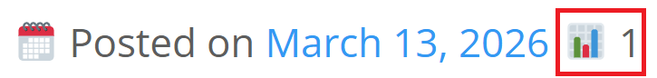

# ABO YUMA Post Views Counter

 
 
 


A lightweight custom WordPress plugin to track unique post views using IP + Transients.  
Built specifically for the ABO YUMA theme.



## ✨ Features

- Count unique views per IP (24 hours)
- Ignore bots (basic user-agent filtering)
- Ignore admin users
- Uses WordPress Transients for performance
- Stores view counts in post meta
- No external database tables required
- Works automatically on single post pages

## ⚙️ Installation

1. Upload the plugin folder to `/wp-content/plugins/`
2. Activate the plugin from the WordPress admin panel

## 🎨 Display in theme

```php
if (function_exists('aboyuma_get_post_views')) {
    echo aboyuma_get_post_views(get_the_ID());
}
```

### For ABO YUMA theme
The theme will automatically detect the plugin and display post views if available.
